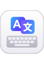

### Jae Ung Jang

Currently focused on building apps for 🇰🇷 Korean learners.

###### LEARN

&nbsp; <a href="https://apps.apple.com/us/app/korean-ai-tutor-sai-korean/id6759949961"><b>SAI Korean</b></a>&nbsp; Voice calls with Korean AI friends 
&nbsp; <a href="https://apps.apple.com/us/app/lightning-topik/id6824856155"><b>Lightning TOPIK</b></a>&nbsp; TOPIK words with moving pictures 
&nbsp; <a href="https://apps.apple.com/us/app/korean-word-camera-chalkak/id6793417746"><b>Chalkak</b></a>&nbsp; Snap anything, collect its Korean word

###### WRITE

&nbsp; <a href="https://apps.apple.com/us/app/fix-my-korean-grammar-check/id6801418952"><b>Fix My Korean</b></a>&nbsp; Grammar check that shows you why 
&nbsp; <a href="https://apps.apple.com/us/app/type-natural-korean-keyboard/id6813025774"><b>Type Natural Korean</b></a>&nbsp; Checks your Korean in any app 
&nbsp; <a href="https://apps.apple.com/us/app/sendwell-translator-keyboard/id6816119364"><b>Sendwell</b></a>&nbsp; Write well in a second language

Seoul &nbsp;·&nbsp; [LinkedIn](https://www.linkedin.com/in/jaeungjang/) &nbsp;·&nbsp; jjw3435@gmail.com
